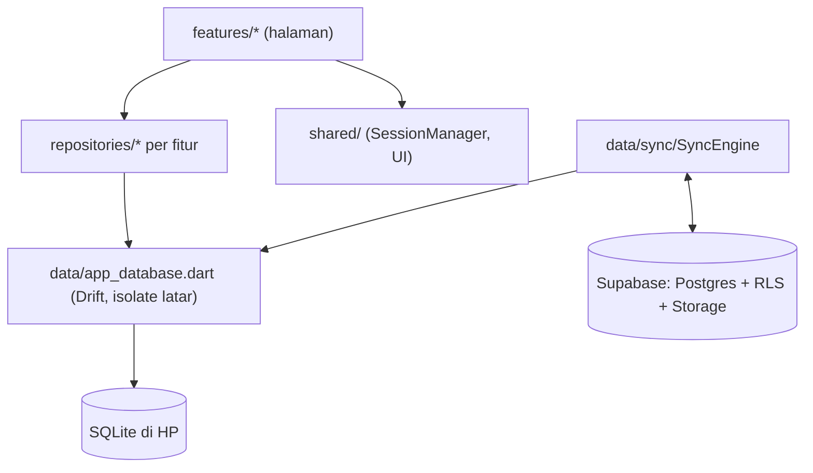

# Arsitektur Kasir App

Dokumen ini adalah **peta besar** kode: *di mana* sesuatu berada dan *aturan
main* yang menjaga kode tetap konsisten. Detail per baris ada di komentar kode —
komentar di project ini sengaja panjang dan menjelaskan *kenapa*.

---

## 1. Gambaran umum

Kasir App adalah POS untuk **satu usaha (Teras Inn)** dengan beberapa HP:

1. **Local-first** — setiap HP menyimpan seluruh data di SQLite (Drift). Kasir
   tetap bisa berjualan tanpa internet.
2. **Sinkron ke Supabase** — perubahan dikirim ke server dan ditarik HP lain.
   Server juga menjaga aturan penting, karena HP bisa offline lama atau
   dibongkar.
3. **Perangkat terdaftar** — hanya HP yang didaftarkan owner yang boleh
   membaca/menulis data server (RLS `perangkat_aktif()`).
4. **Peran & izin** — Owner (akses penuh) vs Kasir (7 izin yang diatur owner).

> Dulu ada arsitektur **multi-business** (Teras Inn + Thai Tea). Arsitektur itu
> dibuang di skema v13; sisa catatannya di `docs/research/` tinggal sejarah.

## 2. Peta kode

```
lib/
├── main.dart                 # Inisialisasi + AuthFlowHandler (layar awal)
├── app/
│   ├── app_shell.dart        # Sesudah login: KerangkaOwner atau KerangkaKasir
│   ├── kerangka_owner.dart   # Navigasi bawah owner (tengah: Produk)
│   ├── kerangka_kasir.dart   # Navigasi bawah kasir (tengah: Kasir) + keranjang
│   ├── penjaga_perangkat.dart# Layar dicabut / daftar perangkat di atas segalanya
│   ├── keluar_akun.dart
│   └── app_theme.dart        # buildAppTheme(seed) — warna brand Teras Inn
├── data/
│   ├── app_database.dart     # Tabel Drift, SEMUA query, migrasi (skema v42)
│   ├── app_database.g.dart   # Hasil generate — JANGAN diedit
│   ├── db.dart               # Instance global `db`
│   ├── sync/                 # SyncEngine (tarik/kirim), SyncOtomatis, foto
│   ├── supabase/             # Klien, konfigurasi, sesi aman, cek server
│   └── perangkat/            # Pendaftaran HP, kode nota per HP
├── features/                 # feature-first: 1 folder = 1 modul
│   ├── auth/  onboarding/    #   login, setup owner, recovery
│   ├── dashboard/  profil/
│   ├── sales/  open_bill/    #   kasir, keranjang, pembayaran, open bill
│   ├── history/  report/     #   riwayat transaksi, laporan + unduh
│   ├── shift/  expenses/     #   shift (buka/tutup/riwayat/detail), pengeluaran
│   ├── products/             #   produk & kategori
│   ├── owner/                #   kelola kasir & hak akses
│   └── perangkat/            #   daftar perangkat (owner)
├── shared/
│   ├── auth/                 # SessionManager, aturan username, cakupan riwayat
│   ├── ui/  widgets/         # komponen UI bersama (kartu, lembar, toast, …)
│   └── services/             # simpan foto, simpan/bagikan berkas
└── utils/                    # rupiah, kripto PIN, pesan galat, dll.
```

Aturan lapisan: **halaman → repository fitur → `AppDatabase` (Drift)**.
Halaman tidak menulis SQL sendiri.

## 3. Alur layar awal

```
main()
 ├─ initializeDateFormatting('id_ID'), ImageStorageService.init()
 ├─ SupabaseService.init()            # klien server
 ├─ SessionManager.restoreSession()   # sesi login lama (dicek ulang ke DB)
 ├─ PerangkatRepository.muatTandaDicabut()
 ├─ sinkron awal (latar) + SyncOtomatis.mulai()
 └─ runApp → PenjagaPerangkat → AuthFlowHandler
        ├─ HP dicabut          → layar "HP ini dicabut" (tanpa kolom kunci)
        ├─ HP belum terdaftar  → Daftarkan Perangkat (kunci pemasangan)
        ├─ pasang pertama, server tak terjangkau → "Perlu internet"
        ├─ belum ada akun      → Onboarding (setup owner + recovery code)
        ├─ belum login         → Login
        └─ sudah login         → AppShell → KerangkaOwner / KerangkaKasir
```

Penyiapan pertama **wajib online** (supaya tidak lahir owner kedua).
Sesudahnya aplikasi jalan penuh offline.

## 4. Sinkron (`data/sync/`)

- **Tarik dulu, baru kirim.** Tarikan berhenti di kegagalan pertama (urutan
  induk → anak); pengiriman tetap jalan per tabel karena data yang belum
  terkirim hanya ada di HP itu.
- **Penanda tarik = `server_urut`** (jam kedatangan di server) + `id`, per tabel,
  disimpan di `sync_state`. Ditarik per halaman 500 baris.
- **Baris yang ditolak HP** (mis. aturan isian belum dikenal) disisihkan ke
  `baris_tertahan`, tarikan jalan terus, dicoba ulang berkala.
- **Server menang kalau lebih baru** (dibandingkan per detik `updated_at`).
- **Otomatis:** tiap 5 menit, sesudah aksi penting, saat kembali ke aplikasi;
  ditunda selama keranjang berisi. Owner/kasir juga bisa tarik layar.

Penjaga di server (`supabase/`, lihat [database-schema.md](database-schema.md)):
`tolak_versi_lama` (versi lebih tua tidak menimpa), `kunci_kolom` (total,
nominal, kas awal, role tidak bisa diganti), `shift_gabung` (shift dobel dari
dua HP offline digabung), RLS per perangkat.

## 5. Izin & sesi

- **`SessionManager`** (`shared/auth/session_manager.dart`) — sesi login,
  izin, shift yang dipegang. Role & izin **selalu dibaca ulang dari DB** saat
  sesi dipulihkan.
- **Izin ditegakkan di repository**, bukan hanya dengan menyembunyikan menu:
  `requireOwner()` / `requirePermission(kode)` melempar `IzinDitolak`.
- **Hak semua akun** (bukan izin): menu Riwayat dan shift sendiri.
  `CakupanRiwayat` menentukan seberapa jauh riwayat boleh dilihat
  (owner: semua; `view_history`: milik sendiri; selain itu: shift berjalan).
- **Sesi berakhir** setelah 15 menit layar tidak disentuh (owner, dan kasir
  yang memegang shift — server langsung diberi tahu shift-nya dilepas) dan
  paling lama 12 jam.

## 6. Keamanan

- **PIN 6 digit** di-hash PBKDF2-HMAC-SHA256 + salt; perbandingan
  *constant-time*. Verifikasi berjalan di isolate latar.
- **Salah PIN**: penundaan bertahap; **10 kali** → akun terkunci sampai owner
  mereset PIN (owner sendiri: lewat recovery code).
- **Username** hanya `a–z 0–9 . _`, 3–20 karakter, login harus persis.
- **Perangkat**: identitas & tiket login server disimpan di brankas HP
  (`flutter_secure_storage`). HP yang dicabut langsung berhenti dan tetap
  terkunci walau dibuka ulang offline.
- **Kunci Supabase** di `supabase_config.dart` memang publik (anon key) —
  yang menahan adalah RLS, bukan kerahasiaan kuncinya.

## 7. Shift

- Dibuka **manual** dengan **kas awal**; satu shift boleh dipegang beberapa HP
  (kasir pindah HP tidak melahirkan shift baru).
- **Kas akhir** = kas awal + penjualan tunai − pengeluaran shift (dihitung,
  tidak disimpan).
- **Tutup shift wajib online** — supaya HP lain yang masih memegangnya tidak
  ikut terputus diam-diam.
- Shift yang ditutup dari HP lain: HP ini dilepas dari shift itu dan penjualan
  ke shift tersebut ditolak. Shift yang **digabung server** (dua HP offline
  membuka shift bersamaan): sesi pindah ke shift tujuan.

## 8. Aturan yang TIDAK boleh dilanggar

1. **Tabel yang disinkron** wajib punya `id` (UUID), `created_at`, `updated_at`,
   `deleted_at`, `sync_status`.
2. **Tidak ada hapus permanen dari HP.** Transaksi & pengeluaran **dibatalkan**
   (alasan + siapa, disimpan selamanya); produk/kategori ditandai `deleted_at`
   dan baru dibuang server (`buang_sampah`) setelah semua HP menerima kabarnya.
3. **Migrasi menjaga data** — tidak ada `deleteTable` untuk data asli. Migrasi
   yang menambah kolom ke tabel yang disinkron wajib mengosongkan penanda tarik
   tabel itu.
4. **Izin dicek di repository**, bukan hanya di tampilan.
5. **Jangan percaya role/izin dari storage** — selalu dari DB.
6. **Perubahan server = berkas SQL baru** di `supabase/`, dicatat di
   `URUTAN.md` (dicek test arsitektur), aman dijalankan ulang, dan fungsi baru
   ditutup dari `anon`.
7. **Jangan edit `app_database.g.dart`.**

## 9. Diagram lapisan


